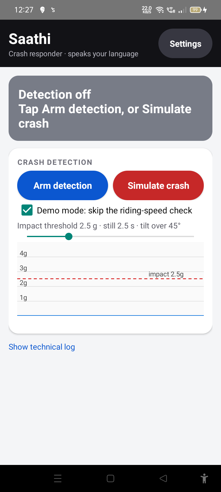
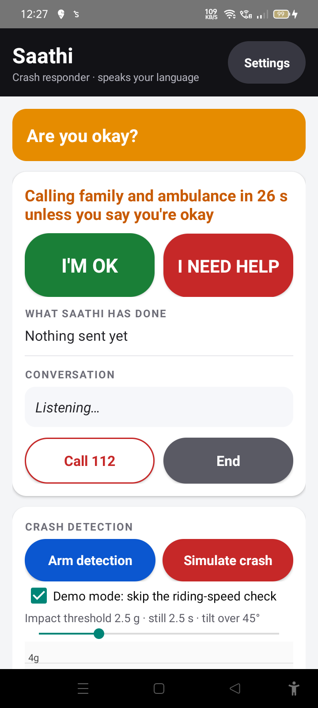
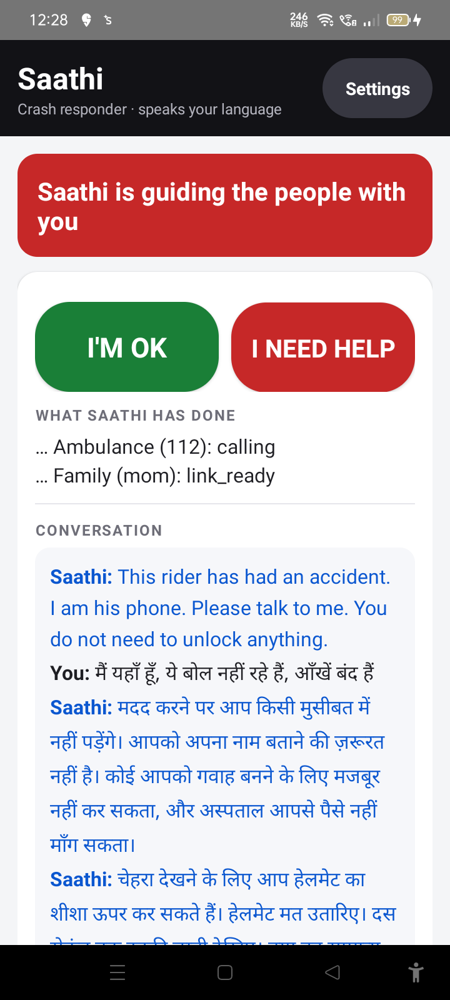
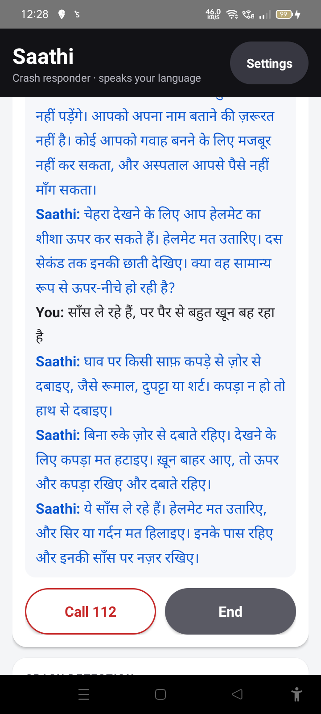
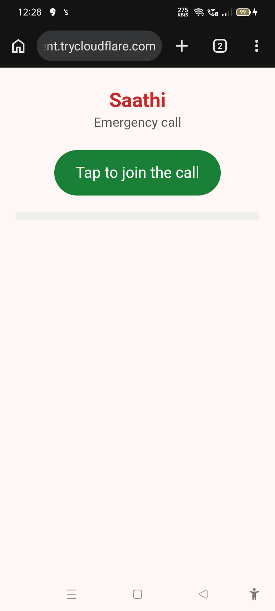
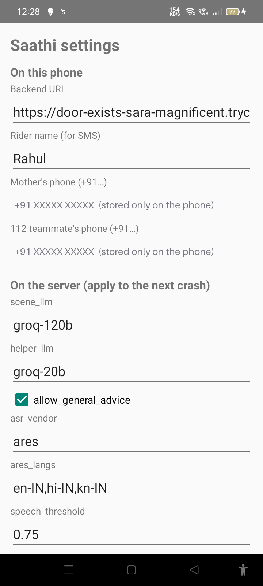
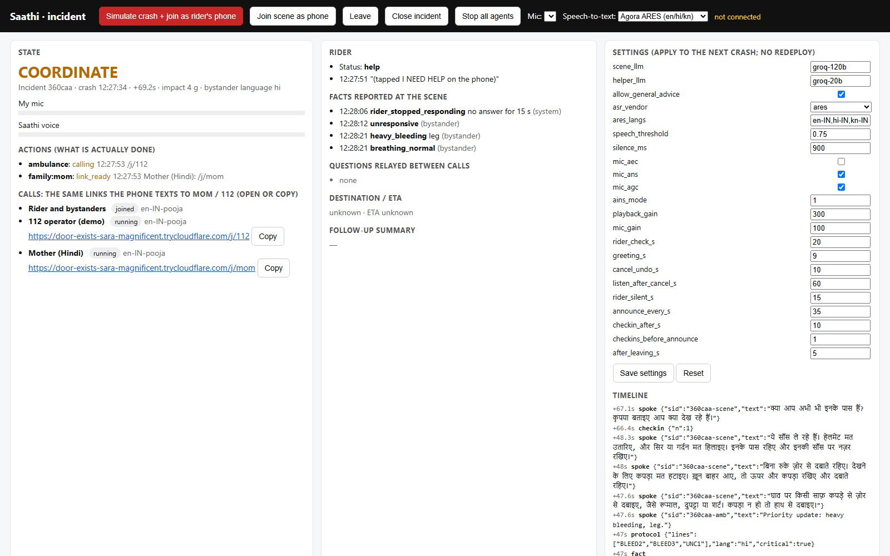
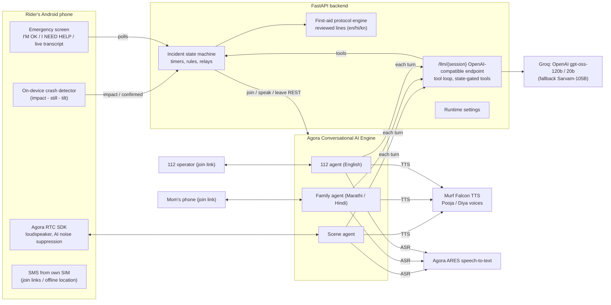

# Saathi: a voice crash responder for two-wheeler riders

**Saathi turns a rider's phone into a voice responder for the first 10 minutes after a crash.** It detects the fall, checks on the rider in his language, talks the people nearby through first aid in *their* language, calls his family and 112, and briefs the paramedic. Nobody has to unlock the phone.

*Built in one day for **Build with Agora, Bengaluru (21 Nov 2026)**, Track 5: Voice AI for Bharat.*

> In 2023, two-wheeler riders were **44.8 % of India's road deaths: 77,539 people** (MoRTH, *Road Accidents in India 2023*). Bengaluru recorded 915 road deaths, 55 % of them on two-wheelers (NCRB 2023). After a crash, bystanders usually want to help, but the phone is locked, nobody knows what to say, the family speaks another language, and people fear police trouble.

## Screenshots

| Watching for a crash | "Are you okay?" (20 s countdown) | Help is coming | Live conversation |
|---|---|---|---|
|  |  |  |  |

| Mom's join link | Settings (no redeploy) | Incident dashboard |
|---|---|---|
|  |  |  |

## What happens in a crash

1. **Detect, on the phone:** a sharp impact (above 2.5 g), then stillness for 2.5 s, then the phone tilted more than 45°, only at riding speed. **At impact, the voice agent is already starting in the background**, so the first word comes about **1.5 s after the crash is confirmed**.
2. **Check the rider, in his language (Hindi and English):**
   - *"साथी बोल रही हूँ। आप ठीक हैं? … Saathi here. Are you okay?"*
   - *"I'm fine"* (or the big **I'M OK** button) cancels.
   - **Silence, pain or "help"** escalates.
   - Symptoms he mentions (dizzy, headache, chest pain, …) are recorded.
3. **Engage bystanders on the loudspeaker** in Kannada, Hindi and English: *"This rider has had an accident. I am his phone. Please talk to me…"*
   - Saathi switches to whatever language the bystander speaks.
   - It tells them they're protected by the Good Samaritan law.
   - It works out who is talking: only the rider can cancel, and a bystander's *"he's bleeding"* escalates.
4. **Coordinate, all at once:**
   - **First aid:** from a reviewed protocol, spoken word for word (bleeding, not breathing, unconscious, vomiting, helmet, water, moving him…).
   - **112:** briefed with the location, GPS, condition, blood group and allergies.
   - **Family:** called **in their own language**, for example Marathi or Hindi. Saathi relays facts between them and the scene, so a **Kannada bystander and a Marathi mother can communicate without sharing a language**.
5. **Hand over:** when the paramedic asks *"tell me about him"*, Saathi reads the medical profile and the timeline. The family gets the destination hospital and a summary.
6. **Never silent:** if nobody answers, Saathi checks in, then announces for help again, and tells the family and 112 that nobody is with him.
7. **Offline:** detection still runs, the phone **texts the family the crash location from its own SIM**, and plays reviewed instructions from stored Murf audio.

### Track 5 demo flow

| Step | In Saathi |
|---|---|
| Initiate (Indian language) | Saathi speaks first after a crash, in Hindi and English, then announces in Kannada, Hindi and English |
| Understand (code-mixed) | Agora speech-to-text with Hindi, Kannada and English together; the LLM identifies the speaker, intent and negation |
| Assist | Reviewed first-aid protocol, the Good Samaritan line, and safe general advice when nothing in the protocol fits |
| Execute (tool calls) | Starts the family and 112 agent sessions, sends SMS, relays questions, sets the destination and ETA, reads the handover |
| Confirm and follow up | *"I've reached his mother"*, *"the ambulance team has his location"*, a live "what's done" list, the family summary, and a false-alarm callback |

## Architecture



**The backend decides; the LLM only understands.** A deterministic state machine (`IMPACT → DETECTED → RIDER_CHECK → BYSTANDER → COORDINATE → HANDOVER → CLOSED`, plus `CANCELLED`) owns the timers and rules, and decides which tools the LLM may call in each state.

### How we use Agora and Murf
- **Agora Conversational AI Engine:**
  - a cascading pipeline (ASR → LLM → TTS), controlled from the backend through REST (`join`, `speak`, `leave`, `query`, `history`);
  - **three concurrent agent sessions per incident** (scene, family, 112);
  - **ARES** speech-to-text for English, Hindi and Kannada;
  - a **custom LLM endpoint** with server-side tool calling;
  - the **`speak` API** for reviewed lines, spoken word for word;
  - voice-activity tuning for road noise.
- **Agora RTC Android SDK:** `AUDIO_SCENARIO_AI_CLIENT`, loudspeaker routing, **AI noise suppression**, and a playback boost for traffic noise.
- **Murf Falcon TTS (`falcon-2.1`):** every spoken word, using voices from Murf's recommended Indian list. **`en-IN-pooja`** handles the scene (English, Hindi, Kannada, Tamil, Telugu); family calls use the recommended voice for their language (for example **`gu-IN-diya`** for Marathi). Offline clips are pre-rendered with Murf too.

## Safety by design
- **Reviewed first-aid protocol** ([docs/first_aid_protocol.md](docs/first_aid_protocol.md)): 43 lines in English, Hindi and Kannada.
  - Each line cites its source (ERC 2021, IFRC 2020, AHA 2020, Indian First Aid Manual, MoRTH Good Samaritan rules).
  - The protocol also lists advice we **deliberately don't give**: removing the helmet, tourniquets, water, keys during a fit, toothpaste on burns.
- **Questions outside the protocol:** Saathi gives short, conservative lay first aid that passes a **safety filter** (no medicines, doses, helmet removal…). The question also goes to the 112 operator, and every answer is logged for review. A **strict mode** setting turns this off.
- **Privacy:**
  - family phone numbers are never spoken and never reach the LLM;
  - the medical profile is read only to medical responders, from a template;
  - demo phone numbers stay on the phone.
- **Only the rider can cancel.** After help has been called, "I'm fine" is recorded, not acted on.
- *Prototype note:* medical and language review is open. A doctor or first-aid trainer and native speakers sign off before any real use.

## Repository layout
```
backend/                 FastAPI backend (Python 3.10+)
  workflow.py            incident state machine and orchestration (sessions, timers, relays, handover)
  llm.py                 per-session OpenAI-compatible LLM endpoint (compact context, tool loop)
  tools.py               state-gated tools        protocol.py   facts -> reviewed lines
  llmclient.py           model selection + fallback (Groq keys round-robin -> Sarvam)
  agora.py               ConvoAI REST + RTC tokens   settings.py   runtime settings (GET/POST /settings)
  intent.py, lang.py, advice_guard.py, compose.py
  protocol/first_aid.json   reviewed first-aid lines (single source of truth)
  static/dash.html, static/join.html   incident dashboard, family / 112 join page
  scripts/               check_keys, list_voices, render_protocol, smoke_workflow (full run with a fake Agora)
android/                 Kotlin app: CrashDetector, emergency screen, SMS, Settings, Agora voice SDK
docs/                    scenario map, first-aid protocol, compliance check, demo script, brief, market study
```

## Run it

**Needs:** Python 3.10+, `cloudflared`, an Agora project with Conversational AI enabled, and Murf, Sarvam and Groq API keys. For the app: JDK 17, the Android SDK (platform 35) and an Android phone.

1. **Configure:** `cp .env.example .env` and fill in the keys. Extra `LLM_API_KEY_2..9` keys from **other** Groq accounts add rate-limit capacity; `OPENAI_API_KEY` is optional.
2. **Backend:**
   ```bash
   cd backend
   python -m venv .venv && .venv/bin/pip install -r requirements.txt     # Windows: .venv\Scripts\pip
   .venv/bin/python -m uvicorn main:app --port 8000                       # Windows: .venv\Scripts\python
   ```
3. **Tunnel** (Agora's cloud must reach `/llm`): `cloudflared tunnel --url http://localhost:8000`. Put the URL in `.env` as `PUBLIC_BASE_URL`, then restart the backend.
4. **Dashboard:** open `PUBLIC_BASE_URL/dash` and click **Simulate crash + join as rider's phone**.
5. **Android app:**
   ```bash
   cd android && ./gradlew assembleDebug && adb install -r app/build/outputs/apk/debug/app-debug.apk
   ```
   The backend URL is built in from `PUBLIC_BASE_URL`, or can be typed into the app's Settings. Add the demo phone numbers in Settings.
6. **Checks:**
   - `python scripts/check_keys.py`: checks every key.
   - `python scripts/smoke_workflow.py`: runs the whole flow with the real LLM and a fake Agora, so no minutes are used.

**Settings you can change at runtime** (dashboard or phone, with no redeploy):
- the LLM (`groq-120b`, `groq-20b`, `gpt-4o`, `gpt-4o-mini`, `sarvam-105b`);
- the speech-to-text vendor (ARES or Sarvam);
- the voice-activity threshold and silence length;
- noise suppression and loudspeaker gain;
- all workflow timers;
- strict-protocol mode.

## Docs
- [Scenario map](docs/scenario_tree.md): every scenario from setup to closure, with timers, languages, the offline plan, answers for judges, and future work
- [First-aid protocol](docs/first_aid_protocol.md) · [Hackathon compliance](docs/hackathon_compliance.md) · [Demo script](docs/demo_script.md)
- [Product brief](docs/Saathi%20Voice%20Crash%20Responder%20for%20Two-Wheeler%20Riders%20Updated%201.md) · [Market study](docs/market_study_saathi_v2.md)

## Limits and what's next
- **Detection is hand-tuned on mattress drops** and not yet validated on real crashes. It also runs only while the app is open; a foreground service is next.
- **Family and 112 join through links today.** Real phone calls need Agora's SIP outbound calling with a SIP trunk.
- **Next steps:**
  - an on-device intent model for richer offline help;
  - direct 112 (ERSS) integration;
  - hospital pre-alerts;
  - a helmet or bike sensor;
  - more languages with reviewed protocol lines;
  - clinical sign-off.

## License
[Apache 2.0](LICENSE). The token builder in `backend/agora_token/` is from [AgoraIO/Tools](https://github.com/AgoraIO/Tools).
