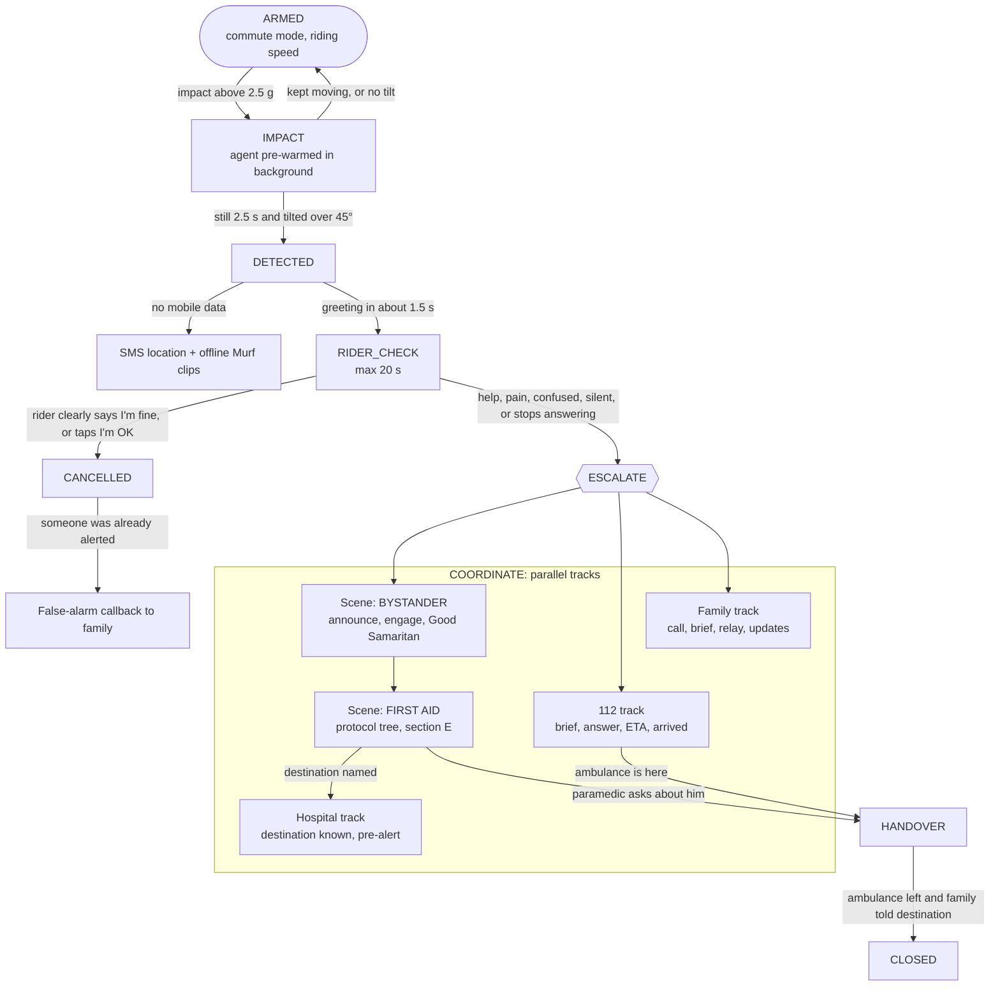
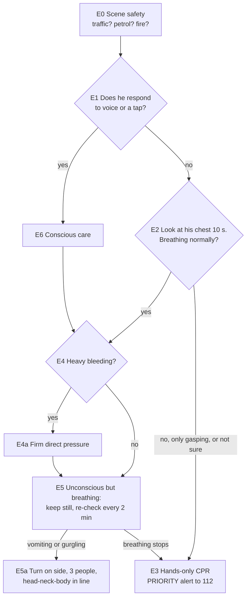

# Saathi scenario map: every path from crash to closure

**Use this for:** deciding what to build next, writing tests, and rehearsing the demo.
Every scenario has an ID (for example `C4`). Use these IDs in code comments, test names, and demo notes.

**Priority tags**
- `[DEMO]` shown live on stage
- `[MVP]` must work by demo day, even if not shown
- `[STRETCH]` build if time allows
- `[LATER]` after the hackathon

**Track 5 steps**
- `T1` initiate in an Indian language
- `T2` understand code-mixed speech
- `T3` assist
- `T4` execute through tool calls
- `T5` confirm and follow up

> **Clinical note.** This is a prototype. The first-aid wording follows published bystander first-aid guidelines, and every line lists its source. Medical and language review is open: a doctor or certified first-aid trainer signs off every line before launch, as the product brief requires.

---

## 1. Design decisions these scenarios force

### 1.1 First aid is a reviewed protocol tree, not a list of lines
A short list of lines can't handle "he's bleeding, what do I do?". A free-form LLM can't be trusted with medical advice either. So first aid works the way 112/108 dispatch protocols do:

- **The LLM** understands the bystander and reports what they said as a structured fact, for example `record_fact(kind="bleeding", value="heavy", where="left leg", speaker="bystander")`.
- **The backend's protocol engine** chooses the next step from the tree in section E. It works on events: any reported life threat jumps straight to that step. Priority order:
  1. not breathing
  2. heavy bleeding
  3. unconscious but breathing
  4. everything else
- **The step is spoken word for word** through the `speak` API, in the bystander's language. The LLM never writes medical text.
- **Questions outside the protocol** ("can I give him a painkiller?") get a fixed holding line. The question goes to the human 112 operator, played by a teammate in the demo. The operator answers by choosing a protocol step on their console. Only if the protocol has no step for it, the operator sends a message, which is clearly labelled as coming from the ambulance team.
- **The reviewed wording** lives in [`backend/protocol/first_aid.json`](../backend/protocol/first_aid.json), rendered for review as [first_aid_protocol.md](first_aid_protocol.md). Every line lists its source guidelines (ERC 2021, IFRC 2020, AHA 2020, Indian First Aid Manual, MoRTH Good Samaritan rules). That file also lists the common advice Saathi **deliberately doesn't give** (removing the helmet, raising the limb, tourniquets, water, keys during a fit, toothpaste on burns), with the reason for each.

### 1.2 The rider is tracked separately from the conversation
The backend keeps a rider record:
- the last time he answered
- what he said, word for word
- whether his answers made sense
- a timeline of whether he was conscious and breathing

A change from "talking" to "silent" counts as an event in its own right (scenario `C4`). Once the backend has escalated, the rider saying "I'm fine" **does not cancel automatically** (scenario `C10`). Anyone who was knocked unconscious should be checked by the ambulance team.

### 1.3 One phone mic hears several speakers
Agora hears one mixed audio stream, because ConvoAI subscribes to a single user: the phone. So the agent has to infer who is speaking:
- **content:** "my leg" means the rider, "his leg" means a bystander
- **stage:** early answers are probably the rider
- **language:** the rider's profile language
- **optional:** Agora's SAL voiceprint, using the rider's voice recorded at setup `[verify: whether recognition mode labels speakers or only filters them]`

Every logged utterance carries `speaker = rider | bystander | responder | unknown`. Mistakes are tolerable because both roles lead to the same safe actions. The one dangerous mistake is cancelling on a bystander's "I'm fine, but he's hurt". So **a cancel needs a first-person, unambiguous answer attributed to the rider, during `RIDER_CHECK`**.

### 1.4 Many people in many languages: one incident record, one session per party, facts relayed between them
- **The incident record** is the single source of truth. It holds facts in English, each with its source, time and original wording.
- **One ConvoAI agent session per party**, each in its own Agora channel:
  - **Scene session** (rider and bystanders): follows whoever is speaking. Locale `en-IN`, multi-script text, automatic language detection.
  - **Family session**: language set from the contact's profile, for example `mr-IN`. Because the language is known, speech recognition is pinned to it for better accuracy.
  - **112 session**: English, Kannada or Hindi, played by a teammate.
  - **Hospital session**: English (`[STRETCH]`).
- **Sessions never hear each other.** The scene session's tools write facts into the record. The backend then pushes the record into the family session (with `update` system messages) and triggers a spoken line (with `think`, or with `speak` and a templated sentence). Questions flow the other way through `ask_scene(question)`.
- **Why not live interpretation?** Every sentence would pass through two ASR → LLM → TTS hops, about 4 s each way. People would talk over each other, and freely translating medical content is risky. Relaying facts takes about 3–5 s per hop, which is fine because the parties aren't in a live conversation with each other.

### 1.5 Hospitals: pre-alert the destination, don't choose it
- 112 decides where the ambulance goes.
- Saathi pre-alerts the **destination** emergency department once it's known (`F19`), with a voice briefing, a summary link, or both.
- Saathi suggests the "nearest 24-hour trauma emergency" only when bystanders are transporting him themselves (`F20`). The list is curated and verified in advance, not a live search.

### 1.6 Voice and language coverage
- **Agora can't change the TTS locale during a session.** This is fine, because each party has its own session.
- **The first voice we tested couldn't cover Marathi.** `en-IN-nikhil` only covers en, hi and kn. Murf's Falcon voice list shows:
  - `en-IN-samar` (male): as, en, hi, kn, mr, or, ta, te
  - `hi-IN-poonam` (female): as, bn, en, gu, hi, kn, ml, mr, or, pa, ta, te
- **Decision: `hi-IN-poonam`** for every session. It's the only one of the two that also covers **Bengali**, which the brief names as a likely family language, and it keeps the "one voice" rule. It's a female voice, so Hindi and Marathi first-person verbs use feminine forms ("पूछ रही हूँ").
- Sarvam's speech recognition supports 22 Indian languages, including Marathi.

### 1.7 No data and other failures
- **No data at detection:** an SMS with the crash location goes to the contacts. The phone plays **pre-recorded Murf clips** cached at setup: the announcement, the Good Samaritan line, and core first-aid steps in kn, hi and en. They're still Murf audio, with no network needed, but there's no conversation.
- The full plan for each kind of network failure is in **section 10**.
- **Crash location:** always the **crash point recorded at impact**, never the phone's live location. Someone may walk away with the phone.

---

## 2. Top-level flow and timers

The ambulance and family tracks start **the moment the backend escalates**. They don't wait for a bystander to speak.



| Timer | Value | When it expires |
|---|---|---|
| Stillness window after impact | 2.5 s (after 0.4 s settle) | Crash confirmed: `DETECTED` |
| No stillness after impact | 8 s | False alarm: stop the pre-warmed agent |
| Rider question unanswered | 8 s | Repeat once, louder, using his name |
| `RIDER_CHECK` total | 20 s | Escalate |
| Rider silent after answering earlier | 15 s | Escalate and flag "was talking, now unresponsive" (`C4`) |
| Cancel undo window | 10 s after "I'm fine" | Cancel becomes final unless he says "help" |
| Bystander announcement | every 20 s until someone speaks | — |
| Nobody at the scene | 3 min | Tell family and 112; keep announcing every 30 s |
| Re-check an unconscious patient | every 2 min | "Is he still breathing?" (`E5`) |
| Family call not answered | 45 s | Retry once after 60 s, then the next contact, then SMS to all |
| Ambulance ETA check | every 5 min | Ask 112, tell the bystander and family |
| Session cap | 60 min, or battery below 10 % | Final SMS summary, close |

---

## 3. Scenario tree

### A. Before any crash (setup)
- **A1** Profile: name, blood group, allergies, conditions, medicines. `[MVP: hard-coded demo profile]`
- **A2** Emergency contacts in priority order, each with **their language**, plus employer HR as the last fallback. `[MVP: one contact]`
- **A3** Languages: the rider's mother tongue, the other languages he understands, where he rides, and each contact's language. Details in **section 9**. `[MVP]`
- **A4** Consent under the DPDP Act: medical data is stored on the phone and shared only in an emergency. `[LATER]`
- **A5** Commute mode (hours) and the riding-speed gate (15 km/h). `[MVP: gate built, demo switch skips it]`
- **A6** Optional voice sample for speaker recognition (`1.3`). `[LATER]`
- **A7** Offline Murf clips downloaded to the phone (`1.7`). `[STRETCH]`
- **A8** Practice drill that alerts nobody. `[LATER]`
- **A9** ColorOS and other brands kill background apps: guide the rider through battery settings. `[LATER]`

### B. Detection
- **B1** Real crash at riding speed: impact, then still, then tilted, then `DETECTED`, with the agent already warm. `[DEMO]` *(built and measured: greeting 1.5 s after confirmation)*
- **B2** Phone dropped while walking or parked: the speed gate blocks it. The demo switch skips the gate. `[MVP]` *(built)*
- **B3** Pothole or speed-breaker spike, and the rider keeps riding: no stillness, so the agent is stopped. `[DEMO: optional]` *(built)*
- **B4** Phone falls off its mount, rider fine and stops to pick it up: `DETECTED`, then "I'm fine", then `CANCELLED`. `[DEMO beat 2]`
- **B5** Crash, but the phone lands metres from the rider: the voice may not reach him, but the bystander path works (the phone is on the road where people gather). `[MVP]`
- **B6** Low-speed skid below the gate: missed. Offer a manual "I've crashed" button and a hold-to-SOS gesture. `[LATER]`
- **B7** Crash during a phone call, music or navigation: Saathi takes audio focus `[verify behaviour on ColorOS]`. `[LATER]`
- **B8** Bluetooth earbuds or helmet headset connected: run `RIDER_CHECK` through the earbuds (he hears it even if the phone is far away), then **force the loudspeaker** for `BYSTANDER`. `[STRETCH]`
- **B9** No mobile data at `DETECTED`: SMS with the crash location to contacts, plus offline clips. `[MVP: SMS]`
- **B10** The agent fails to start at impact: retry at confirmation *(built)*. If it still fails, offline clips and SMS. `[MVP]`
- **B11** Battery critical: SMS first, short session, no small talk. `[LATER]`
- **B12** Phone locked: the app wakes over the lock screen, so nobody has to unlock anything. *(Activity flag built; a foreground service is needed when the app is in the background `[LATER]`.)*
- **B13** Phone dropped again by a bystander during a session: ignore impacts while a session is active. `[MVP]`

### C. Rider check (first ~20 s) — `T1`, `T2`
The greeting comes first in the rider's profile language, then Kannada, then Hindi and English.
- **C1** Clear "I'm fine" / "ನಾನು ಚೆನ್ನಾಗಿದ್ದೇನೆ" / "मैं ठीक हूँ" from the rider: "Okay, cancelling. Say *help* if you need me." After the 10 s undo window, `CANCELLED`. Nothing is sent and detection re-arms. `[DEMO beat 2]`
- **C2** The rider taps a big **I'm OK** button: same as `C1`. This covers noisy roads. `[MVP]`
- **C3** "Help", pain, or "my leg…": **escalate at once**. Ask at most two questions ("Where does it hurt?", "Can you breathe normally?") and record the answers word for word. `[DEMO beat 3]`
- **C4** The rider answers, then goes silent (talking, then unresponsive): repeat once using his name, then escalate. Record both times and flag "**was talking, now not responding**" to 112, the family and the handover. `[DEMO beat 3]`
- **C5** No response at all for 20 s: escalate. `[MVP]`
- **C6** Confused, slurred or irrelevant answers: treat as *not okay*. "I'm fine" from a confused rider doesn't cancel. Escalate with the note "confused speech". `[MVP]`
- **C7** The rider says "I'm fine" but a bystander says "he's bleeding": safety wins. Stay escalated and ask the rider to stay still. `[MVP]`
- **C8** The rider says "don't call my mother" or "call my wife": record the wish. The family track follows it if it's clear. The ambulance is still called if he's injured. `[STRETCH]`
- **C9** The rider speaks a language not in his profile: follow the detected language. `[MVP]`
- **C10** The rider says he's okay **after** escalation: don't auto-cancel. Record "rider says he's okay at T" and tell the family that fact; the ambulance team decides. If it's clearly a false alarm (no injury, he's walking around), send the false-alarm callback. `[MVP]`
- **C11** Road noise, speech not understood: ask him to repeat once, then treat it as no answer. `[MVP]`

### D. Scene: bystander mode — `T1`, `T2`
- **D1** Loudspeaker announcement in Kannada, Hindi and English: "This rider has had an accident. I am his phone. Please talk to me. You don't need to unlock anything." Repeat every 20 s until someone answers. `[DEMO beat 4]`
- **D2** A bystander answers in Kannada (code-mixed): switch to Kannada and stay there. `[DEMO beat 4]`
- **D3** Language changes mid-way, or a second bystander speaks Hindi: answer each person in their own language. `[MVP]`
- **D4** Several people talking at once: "Please, one person talk to me." Continue with whoever answers. `[MVP]`
- **D5** The bystander is afraid of the police: give the Good Samaritan line right after their first reply. "You're protected by law. You don't have to give your name, be a witness, or pay the hospital." `[DEMO beat 4]`
- **D6** "Who are you? Is this a call?": "I'm Saathi, an emergency app on his phone." Add "I've informed the ambulance and his family" **only once the record says so**. `[MVP]`
- **D7** The bystander asks for the family's number: never read it out. "I'm calling them myself. I can pass on a message." `[DEMO: optional]`
- **D8** The bystander tries to unlock the phone to call: "You don't need to. I'm making the calls." `[MVP]`
- **D9** Nobody at the scene for 3 min: keep announcing every 30 s. Tell the family and 112 "nobody is with him yet" and SMS the crash location. `[MVP]`
- **D10** Someone walks off with the phone (to make a call, or theft): the ambulance gets the crash point fixed at impact. Live location is tracked separately, and the agent keeps talking. `[MVP]`
- **D11** A bystander speaks Tamil, Telugu or Urdu: speech recognition detects it. The voice covers ta and te after the voice switch in `1.6`. Urdu is close to Hindi. Otherwise, fall back to English. `[STRETCH]`
- **D12** Joking, hostile or testing bystanders: stay on script and don't argue. `[MVP]`
- **D13** Police arrive: give them the crash time and location, and say the ambulance and family are informed. No medical profile (see section 5). `[STRETCH]`
- **D14** The bystander wants to drive him to hospital: go to `E-TRANSPORT`. 112 decides. `[MVP]`

### E. First-aid protocol tree (spoken word for word, draft for review) — `T3`
The engine jumps to the **highest-priority threat reported**, whatever step it's on. It moves on when it gets an answer. It asks again if there's no answer for 15 s.



The exact spoken wording for every node is in [first_aid_protocol.md](first_aid_protocol.md), in English, Hindi and Kannada. This table maps the tree to line IDs.

| Node | Trigger | Lines spoken | Tag |
|---|---|---|---|
| **E0** Scene safety | always first, briefly | `SAFE1`; `SAFE2` if engine, fire or petrol; `SAFE3` if someone wants to move him | `[MVP]` |
| **E1** Responsiveness | start | `RESP1`, then `VISOR1` for a full-face helmet | `[DEMO beat 4]` |
| **E2** Breathing | unresponsive | `BREATH1`; `BREATH2` if they're unsure or describe gasping. Unsure counts as **not breathing**. | `[DEMO beat 4]` |
| **E3** Hands-only CPR | not breathing normally | `CPR0` (only if face down), `CPR1` → `CPR2` → `CPR3`, `CPR4` if asked about the helmet. **Priority re-brief to 112.** | `[MVP]` |
| **E4 / E4a** Heavy bleeding | asked by `BLEED1`, or reported ("ರಕ್ತ / खून / blood") | `BLEED2` → `BLEED3`; `BLEED4` plus priority to 112 if it won't stop | `[DEMO beat 4]` |
| **E5** Unconscious, breathing | E2 = yes | `UNC1`, then `UNC2` every 2 min | `[DEMO beat 4]` |
| **E5a** Vomiting or gurgling | reported | `VOMIT1` → `VOMIT2` | `[MVP]` |
| **E6** Conscious | E1 = yes | `CONS1` → `CONS2` → `CONS3` (his answer is recorded word for word) | `[MVP]` |
| **E7** Deformed limb, visible bone | reported | `FRAC1` | `[STRETCH]` |
| **E8** Object stuck in the body | reported | `OBJ1` | `[STRETCH]` |
| **E9** Seizure or fitting | reported | `SEIZ1`, then E2 when it stops | `[STRETCH]` |
| **E10** Burns | reported, no higher threat | `BURN1` | `[STRETCH]` |
| **E11** More than one casualty | "two people hurt" | `MULTI1`, then E1 for each; tell 112 the count | `[STRETCH]` |
| **E12** Bike lying on him | reported | `PIN1` | `[MVP]` |
| **E-HELMET** | "Should I take the helmet off?" | `HELMET1` | `[DEMO beat 4]` |
| **E-WATER** | water, food, tea or medicine | `WATER1` | `[MVP]` |
| **E-TRANSPORT** | bystander wants to drive him | `TRANS1`. `TRANS2` **only after the 112 operator approves**. | `[MVP]` |
| **E-OUT** | anything else | `HOLD`, and the question goes to 112 (`F2`) | `[MVP]` |
| **E-GS** | first bystander reply | `GS1` | `[DEMO beat 4]` |

Every line is at most 430 bytes in every language, under Agora's 512-byte `speak` limit. `render_protocol.py` fails if an edit breaks that.

### F. Coordination — `T4`, `T5`
**Ambulance (112, played by a teammate; never actually dialled)**
- **F1** Brief on escalation:
  - crash point with a landmark, and the time
  - conscious? breathing? bleeding?
  - how many people are hurt
  - a bystander is present: yes or no
  - "automated emergency app speaking for the rider"

  `[DEMO beat 5]`
- **F2** 112 asks something: answer from the record, or relay it to the scene and bring back the bystander's answer. `[MVP]`
- **F3** 112 gives an ETA or instructions: the bystander hears them in their language, and the family gets the ETA. `[DEMO: optional]`
- **F4** 112 busy or unreachable (in real life): ask the bystander to call 112 from their own phone, and send an SMS to 112 `[verify ERSS SMS]`. `[LATER]`
- **F5** "Not breathing" reported: priority re-brief immediately. `[MVP]`
- **F6** "The ambulance is here" / "ambulance aa gaya": go to `HANDOVER`. `[DEMO beat 6]`
- **F7** Ambulance delayed more than 20 min: raise the `E-TRANSPORT` question with 112. `[STRETCH]`

**Family**
- **F8** Contact 1 is reached by join link (or SIP if a trunk is available), **in their language**. They hear:
  - what happened
  - where, with a landmark
  - whether he was talking
  - that the ambulance has been called

  Anything else gets "**I don't know yet**". `[DEMO beat 5]`
- **F9** A family question the record can answer is answered straight away. One it can't goes to `ask_scene`, then to the bystander, and the answer comes back (section 4). `[DEMO beat 5]`
- **F10** Proactive updates: ambulance arrived, destination hospital, his condition changed. `[DEMO beat 5]`
- **F11** Panic, crying or shouting: slow down and repeat the key facts. Never say "he's fine" or "it's serious". `[MVP]`
- **F12** "Is he alive?": facts only, for example "He was breathing at 2:46. The ambulance team is with him." `[MVP]`
- **F13** "Let me talk to the person there": explain that Saathi passes messages because they speak different languages, then relay. `[STRETCH]`
- **F14** "Take him to X hospital": relay it to the bystander and 112 as a *request*. The ambulance decides. `[STRETCH]`
- **F15** No answer: retry once, then the next contact, then an SMS to all contacts, then employer HR. `[MVP: SMS]`
- **F16** The family calls the rider's phone (a normal call) and a bystander picks up. Android doesn't let apps hear or speak into normal calls, so Saathi can't interpret it. Plan:
  - Notice the ringing and say on the loudspeaker: "If this is his family, you can tell them Saathi is calling them in their language."
  - Start or refresh the family session at once, and send an SMS with the crash location.
  - After the call, ask "Was that his family? What did they say?"
  - Auto-declining family calls needs call-screening or phone permissions `[verify on ColorOS]`.

  `[LATER]`
- **F17** False alarm after the family was alerted: call back with "False alarm, he's okay." `[MVP]`
- **F18** No contacts configured: only 112 and the bystander. `[MVP]`

**Hospital**
- **F19** Destination learned ("ಮಣಿಪಾಲ್‌ಗೆ ಕರ್ಕೊಂಡು ಹೋಗ್ತಿದ್ದಾರೆ" / "taking him to Manipal"):
  - record it and tell the family `[DEMO beat 5]`
  - pre-alert that hospital's emergency department with a voice briefing or a summary link: medical profile, crash time, how it happened, conscious and breathing timeline, first aid given, ETA `[STRETCH]`
- **F20** Bystanders take him themselves: suggest the nearest 24-hour trauma emergency from a curated Bengaluru list, then pre-alert it. `[LATER]`
- **F21** The hospital asks questions: answer from the record. `[LATER]`

### G. Handover and closure — `T5`
- **G1** A paramedic says "Tell me about him". The backend reads, from a **template**, so the profile never enters the LLM:
  - the medical profile: blood group, allergies, conditions, medicines
  - the timeline: crash time, impact size, his words, the conscious and breathing timeline, first aid given, who was called

  `[DEMO beat 6]`
- **G2** Someone who isn't a medical responder asks about his medical history: "I'll share that with the ambulance team." `[MVP]`
- **G3** Police ask: time, location, and who has been informed. No medical history. `[STRETCH]`
- **G4** The phone goes into the ambulance with him: keep the session briefly, then close and send the family an SMS summary with the hospital. `[STRETCH]`
- **G5** The phone is left with a bystander: ask them to hand it to the police or the ambulance crew. Close 2 min after the ambulance leaves. `[LATER]`
- **G6** `CLOSED`: final SMS summary, stop every agent session, keep the incident record for a short, fixed time, then delete it. `[MVP: minimal]`
- **G7** `CANCELLED`: re-arm. If anyone was alerted, the false-alarm callback (`F17`). `[MVP]`

### H. Failures that can happen at any point
| ID | Failure | Fallback | Tag |
|---|---|---|---|
| H1 | Mobile data lost mid-session | Agora reconnects; after 20 s, offline clips and SMS | `[STRETCH]` |
| H2 | Backend or tunnel down | Agora speaks the `failure_message`; the phone shows red; SMS | `[MVP]` |
| H3 | LLM slow or timing out | `failure_message`: "Please wait, help is being arranged." | *(built)* |
| H4 | Groq free-tier limit (about 30 requests/min) with 3 sessions at once | Fall back to a second provider (Sarvam-105B) through the same `/llm` endpoint | `[MVP: check]` |
| H5 | Speech recognised as the wrong language (we saw a Hindi bias) | Pin the language for family and 112 sessions; scene stays on auto | `[MVP]` |
| H6 | Murf TTS fails | The phone shows the line as big text | `[LATER]` |
| H7 | Speaker muffled in a bag or damaged | Big on-screen text; announce louder | `[LATER]` |
| H8 | The agent hears its own loudspeaker | `AUDIO_SCENARIO_AI_CLIENT` plus echo cancellation; test at full volume | `[MVP]` *(scenario set)* |
| H9 | Too many agent sessions or too much cost | Exactly one per party; `idle_timeout`; stop all at close | `[MVP]` |
| H10 | The phone brand kills the app in the background | Foreground service and battery whitelist | `[LATER]` |
| H11 | `speak` text over 512 bytes | Split into chained `APPEND` speaks | `[MVP]` |

---

## 4. Walkthrough: Kannada bystander ↔ Marathi mother

```mermaid
sequenceDiagram
  participant B as Bystander (Kannada)
  participant S as Scene agent
  participant R as Backend: incident record + protocol engine
  participant F as Family agent (Marathi)
  participant M as Mother
  B->>S: "ಕಾಲಿನಿಂದ ತುಂಬಾ ರಕ್ತ ಬರ್ತಿದೆ" (lots of blood from his leg)
  S->>R: record_fact(bleeding, heavy, left leg, bystander)
  R->>S: speak E4a in Kannada, word for word
  R->>F: update(record) + think("Tell her: heavy bleeding from his leg, someone is pressing on it, ambulance called")
  F->>M: same facts, in Marathi
  M->>F: "तो शुद्धीवर आहे का?" (is he conscious?)
  F->>M: from record: "He was talking at 2:44; since 2:45 he isn't answering. Someone is with him."
  M->>F: "कोणत्या हॉस्पिटलला नेणार?" (which hospital?)
  F->>R: ask_scene("Which hospital is he being taken to?")
  R->>S: think("Ask the bystander which hospital")
  S->>B: asks in Kannada
  B->>S: "ಮಣಿಪಾಲ್‌ಗೆ"
  S->>R: record_fact(destination, Manipal)
  R->>F: think("Tell her: they are taking him to Manipal hospital")
  F->>M: in Marathi
```

Rules for the relay:
- Only **facts** cross between sessions, never raw transcripts or phone numbers.
- Family questions are rephrased neutrally for the scene. Medical questions from the family go through the protocol, never through free translation.
- Each hop takes about 3–5 s. Fill the wait with "I'm asking the people with him now."

---

## 5. Who learns what

| Information | Bystander | Family | 112 | Hospital | Police | LLM context |
|---|---|---|---|---|---|---|
| Crash point and time | yes | yes | yes | yes | yes | yes |
| Live phone location | no | yes | yes | no | no | no |
| Rider's name | yes | — | yes | yes | yes | yes |
| Medical profile | no | if they ask | blood group, allergies | **full** | no | **no** (read from a template) |
| Rider's words, timeline | what's needed for first aid | yes | yes | yes | time only | yes |
| Family phone numbers | **never** | — | **never** | **never** | **never** | **never** |
| Bystander's identity | — | not collected | not collected | not collected | not collected | not collected |

---

## 6. The demo path through the tree

| Demo beat (brief) | Scenario path | Track 5 |
|---|---|---|
| 1 Story | — | — |
| 2 False alarm | `B4` → `C1` → `CANCELLED` | T1, T2, T5 |
| 3 The crash | `B1` → `C3` ("my leg…") → `C4` (silent) → escalate | T1, T2 |
| 4 Bystander | `D1` → `D2` (Kannada) → `D5` → `E1`/`E2` → `E4a` bleeding → `E-HELMET` | T2, T3 |
| 5 Family and 112 | `F1` (112 teammate) + `F8` Mom **in Marathi** → `F9` relay ("which hospital?") → `F19` "taking him to Manipal" → `F10` | T4, T5 |
| 6 Handover | `F6` → `G1` paramedic briefing | T5 |

**Branches to show if judges ask:**
- `B3` pothole spike
- `E3` not breathing (CPR plus priority to 112)
- `D7` asking for the family's number
- `G2` a non-medic asking for medical history
- `B9` no data, so SMS

**Cast:**
- rider
- Kannada bystander
- Mom (Marathi, on a second phone, by join link)
- 112 operator (third phone)
- paramedic: can be the 112 teammate

---

## 7. What this changes in the build plan
1. **Incident record and protocol engine** in the backend: the facts store, the tree in section E as data, and the step-picking logic.
2. **LLM tools:**
   - `record_fact`
   - `log_rider_status`
   - `first_aid_answer` (the reply to the current step)
   - `ask_scene`
   - `say_script_line(id)`
   - `read_handover` (spoken from a template)
   - `cancel_alert` (rider only, `RIDER_CHECK` only)

   The state machine decides which tools each state allows.
3. **Multi-session manager:** scene, family, 112 and hospital sessions, each with its own channel, language and prompt, plus relay through `update` and `think`.
4. **Voice switch to `hi-IN-poonam`:** done in `.env` (Marathi, Tamil, Telugu, Bengali and more now have a voice).
5. **Join-link web page** for family and 112. The browser test page we already have works as a starting point.
6. **SMS fallback** on the phone, and the **I'm OK** button.
7. **Offline clip pack:** a script that renders every line in `first_aid.json` to Murf audio for the chosen languages, the phone downloads them, and the offline loop plays them with the emergency screen card (section 10).
8. **Languages:** a setup screen (section 9.1), the GPS state-to-language map, and per-transcript language detection with sticky switching in `/llm` (section 9.3).

## 8. Assumptions to verify
- The payload of Agora's `think` endpoint (only its name and purpose are confirmed). If it doesn't work, use `update` plus a templated `speak`.
- Whether Agora SAL's "recognition" mode can label speakers.
- How well `hi-IN-poonam` sounds in Kannada and Marathi with the fixed `en-IN` locale (listen in the next live test).
- How many ConvoAI agents our project can run at once.
- Groq's limits with three simultaneous sessions.
- 112 India SMS support; call screening and auto-decline on ColorOS.
- Final first-aid and Good Samaritan wording, reviewed by a doctor and checked against the official guidelines.

---

## 9. Languages: setup, detection and switching

### 9.1 What setup asks (once)
1. **The rider:** mother tongue, other languages he understands, and the language Saathi should use with him first.
2. **Where he rides:** home city and state, prefilled from GPS. This sets the default **local language** for bystanders, for example Karnataka → Kannada.
3. **Each emergency contact:** name, relation, phone number, and **the language they understand best**. This fixes the family session's language and speech-recognition language (for example Mom → Marathi).
4. **A preview:** Saathi plays its announcement in the chosen languages, so the rider can hear it once and check it.

### 9.2 When he travels
While detection is armed, the phone looks up which state it's in (Android's geocoder when online, the last known state when offline). It maps the state to a language:
- Karnataka → kn
- Maharashtra → mr
- Tamil Nadu → ta
- Telangana and Andhra Pradesh → te
- Kerala → ml
- West Bengal → bn
- Gujarat → gu
- Punjab → pa
- Hindi-belt states → hi

A Bengaluru commuter who crashes in Pune gets Marathi announcements, while his rider check stays in his own language.

**Who hears which languages first**

| Moment | Order |
|---|---|
| Rider check | the rider's chosen language, then English |
| Bystander announcement | the local language from GPS, then Hindi, then English (three at most, to keep it short) |
| Family | the contact's language |
| 112 | English, or the local language |

### 9.3 Detecting the language and switching to it
- **The scene session runs speech recognition on automatic** (Sarvam `language: "unknown"`). Sarvam writes each language in its own script; in our test it detected Kannada correctly with 0.94 confidence.
- **Agora doesn't pass Sarvam's detected-language code to our LLM endpoint**, so the backend detects the language itself from each transcript:
  - **Script:** Kannada, Tamil, Telugu, Bengali, Gujarati, Gurmukhi, Malayalam and Odia each have their own Unicode block, so a single sentence is enough.
  - **Devanagari is shared** by Hindi and Marathi. Common words tell them apart: Marathi आहे, नाही, काय, मला versus Hindi है, नहीं, क्या, मुझे. The LLM breaks ties.
  - **Latin script** is English, or romanised Hindi ("mera pair"); the LLM decides.
- **Sticky switching:** change language after one sentence of three or more words, or two short replies in a row. That way "OK", "help" or "ambulance" never flips it.
- **Switching** means the backend adds "Reply in Kannada" to each request inside our own `/llm` endpoint, which needs no Agora call. The protocol engine picks the Kannada version of each line. The voice reads any script, though Agora can't change the TTS locale during a session; our Kannada test with the `en-IN` locale sounded right. If a language sounds poor with the fixed locale, the fallback is restarting the scene session with that language's locale. That takes about 1.5 s, and the incident record carries over.
- **"If we have it available":** a language is fully available only when speech recognition, the voice **and** reviewed protocol lines all support it. Otherwise:
  - **Recognition and voice support it, but there are no reviewed lines yet:** conversation in that language, but first-aid lines in the bystander's next best language, announced first: "I'll give the instructions in Hindi."
  - **Nothing supports it:** Hindi, then English.

**Current coverage**

| Language | Sarvam ASR | Murf voice `hi-IN-poonam` (chosen) | Reviewed lines | Status today |
|---|---|---|---|---|
| English | yes | yes | draft | available |
| Hindi | yes | yes | draft | available |
| Kannada | yes | yes | draft, native-speaker check open | available |
| Marathi | yes | yes | not written | conversation works; first-aid lines to translate |
| Tamil, Telugu | yes | yes | not written | conversation works; first-aid lines to translate |
| Bengali, Gujarati, Malayalam, Punjabi | yes | yes | not written | conversation works; first-aid lines to translate |
| Urdu | yes `[check Sarvam list]` | no | — | Hindi fallback |

---

## 10. When the network fails

The rule is to **always do the most that still works, and keep speaking**. Every fixed line also exists as a **pre-recorded Murf clip stored on the phone**: the announcement, the Good Samaritan line, every first-aid line, and the offline loop, in the rider's languages and the local language. Clips are refreshed when a new state's language is needed. So even fully offline, the phone still speaks in the Murf voice, with no local TTS model needed.

| Level | What's still working | What Saathi does | Tag |
|---|---|---|---|
| **L0** | Everything | Full conversation, all tracks | *(built)* |
| **L1** | Data works, but one vendor is down | LLM: switch to a second provider behind our `/llm`. Speech recognition: switch to a second recogniser. Murf down: play the stored clips and show the text on screen. | `[MVP: LLM failover]` |
| **L2** | Data works, but our backend or the agent can't start | Retry the agent every 15 s. Meanwhile: offline loop, SMS to contacts, big on-screen card. Once it's back, join the live session, which picks up from the record. | `[MVP]` |
| **L3** | No data, but calls and SMS work | SMS to contacts with the crash location ("Saathi is offline; please call 112 / call this phone"). Offline loop. A screen card with a **Call 112** button that opens the dialer for the bystander; 112 works on any network, even without balance. The rider can tap **I'm OK**. | `[MVP: SMS + loop]` |
| **L4** | No signal at all | Offline loop and screen card. The SMS is queued and sent as soon as there's signal. | `[STRETCH]` |
| **L5** | Data drops mid-session | Agora reconnects by itself. The scene agent's `idle_timeout` is raised to 120 s so it waits. Meanwhile the phone **repeats the current instruction from its stored clip** (for example "keep pressing"). After 120 s, the backend restarts the session from the record. | `[STRETCH]` |
| **L6** | Phone speaker broken | Screen card only. A helmet or watch sensor is future work. | `[LATER]` |

**The offline loop** (from `first_aid.json`, each clip in the local language, then Hindi, then English, every 30 s):
1. `OFF1`: accident, internet not working, call 112
2. `GS1`: Good Samaritan
3. `HELMET1`: keep the helmet on
4. `OFF3`: if not breathing, push on the chest
5. `OFF4`: if bleeding, press hard
6. `OFF2`: family messaged (only if the SMS really went)

**The screen card** in emergency mode shows the same instructions as large text, the crash time, and a **Call 112** button. Family numbers are never shown. The medical profile shows only behind "For paramedics: press and hold".

**Two practical notes:**
- **Sending SMS automatically** needs Android's `SEND_SMS` permission. That's fine for a sideloaded demo, but Google Play restricts it to approved use cases `[verify the emergency exception]`. The fallback is an SMS composer pre-filled for the bystander to send with one tap.
- **The demo:** turn on airplane mode before the drop, show the offline loop and screen card, then turn airplane mode off and show the SMS going out.

---

## 11. Answers for judges

| Question | Short answer |
|---|---|
| *What if there's no internet?* | Detection runs on the phone. Every instruction is pre-recorded in the same Murf voice and stored on the phone, so it keeps speaking in Kannada, Hindi and English. It texts the family the crash location, and the screen shows a Call 112 button. When the network returns, the full conversation resumes from where it left off. |
| *Isn't AI medical advice dangerous?* | The AI never writes medical advice. It only works out what the bystander said and picks the matching step from a fixed protocol based on ERC, IFRC and the Indian First Aid Manual. Anything outside the protocol goes to a human at 112. |
| *What if he says "I'm fine" but he's confused?* | Confused speech doesn't cancel. And once help has been called, "I'm fine" is recorded, not acted on; the ambulance team decides. |
| *The bystander speaks Kannada and the mother Marathi. How?* | Each person talks to their own Saathi session in their own language. Saathi passes the facts between them, so neither has to understand the other. |
| *What if he talks and then passes out?* | That change is recorded with times and flagged to 112, the family and the paramedic, because it can point to a head injury. |
| *What if nobody is around?* | It keeps announcing every 30 s, and tells the family and 112 that nobody is with him yet. |
| *Phone locked? Thrown away?* | Nobody has to unlock anything. A thrown phone usually lands where people gather, and we send the crash point, not the phone's later position. |
| *Why not run the AI on the phone?* | A budget phone with 3–4 GB of RAM can't run a useful multilingual model in real time today. Our offline mode doesn't need one, because the medical content is fixed anyway. It's on our roadmap (section 12). |
| *Has a doctor checked the first aid?* | This is a prototype. The wording follows published guidelines (ERC 2021, IFRC 2020, AHA 2020, Indian First Aid Manual), and every line records its source. Before launch, a doctor or certified first-aid trainer signs off each line and a native speaker checks each language. Until then, nothing outside the reviewed lines is ever said. |
| *Privacy?* | Family numbers are never spoken or sent to the AI. The medical profile leaves the phone only in an emergency, and is read only to medical responders, from a template. |

---

## 12. Future work (what we've thought through but won't build this weekend)

**Offline intelligence**
1. **A small on-device model for intent.** Detect "fine", "help", "bleeding" or "not breathing" offline and choose the matching stored clip, so the phone can still follow the protocol with no data. Options: a small quantised multilingual model, or Gemini Nano on phones that support it. Limit: RAM and speed on budget phones.
2. **On-device speech recognition** for offline keyword spotting in Kannada, Hindi and English.
3. **Offline speech for changing details** like the address or the time. Murf has no on-device model, so we pre-record as much as possible. A system-TTS fallback would break the "Murf voice only" rule, which is a product decision.

**Reaching help**
4. **Direct 112 integration**: data sent to India's emergency response system instead of a voice briefing.
5. **Real phone calls over SIP** for family, 112 and hospitals (Agora outbound calling with a SIP trunk).
6. **Satellite SOS** on newer phones that have it `[verify availability in India]`.
7. **Alerting nearby Saathi users** over Bluetooth when there's no network at all.
8. **Hospital pre-alert integration**, and choosing the nearest trauma centre using live capacity.

**Detection**
9. **Real crash data** to tune and validate detection, and later a learned detector.
10. **A helmet or bike sensor, or a smartwatch**, for when the phone isn't on the rider.
11. **Background detection** as a foreground service, with guidance for each phone brand's battery settings.

**Coverage and safety**
12. **More languages** (Marathi, Tamil, Telugu, Malayalam, Bengali and others), each with reviewed lines.
13. **Pillion and multi-casualty handling**, including a pillion profile.
14. **Doctor review of the protocol**, native-speaker review of every language, and versioned sign-off.
15. **Speaker recognition** from the rider's voice sample, to tell the rider and bystanders apart reliably.
